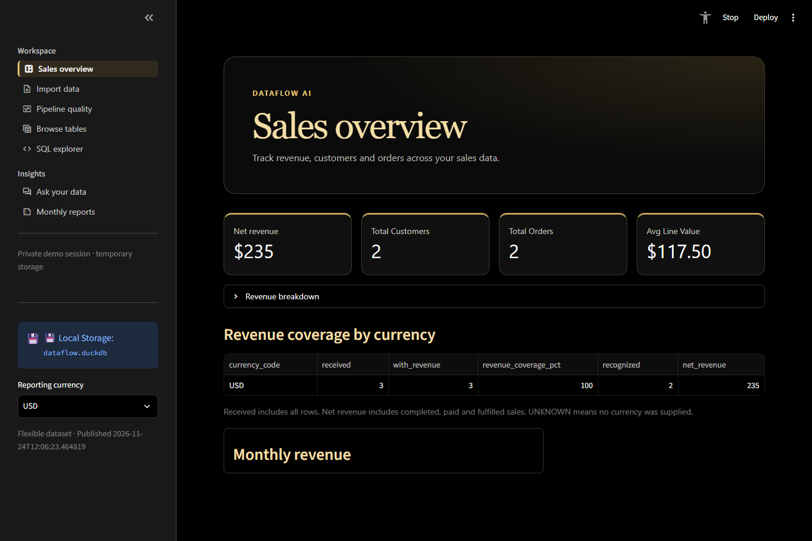
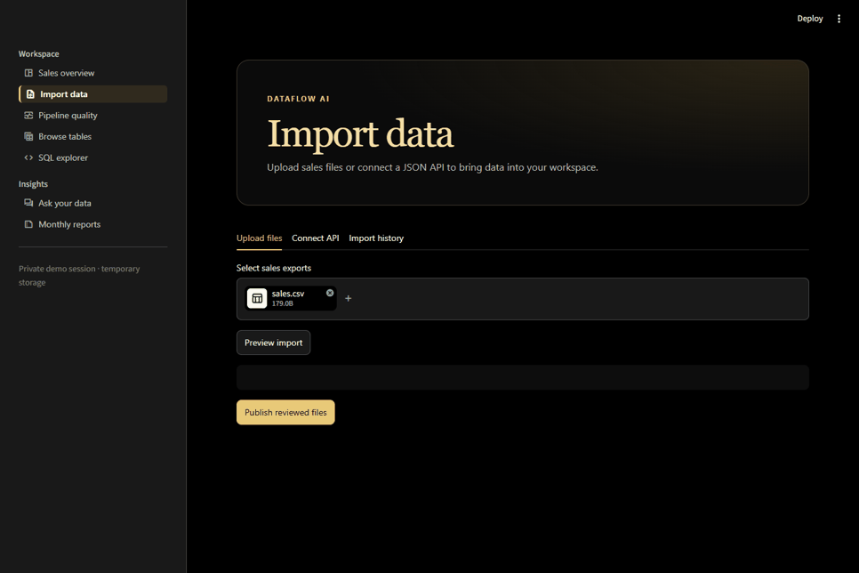
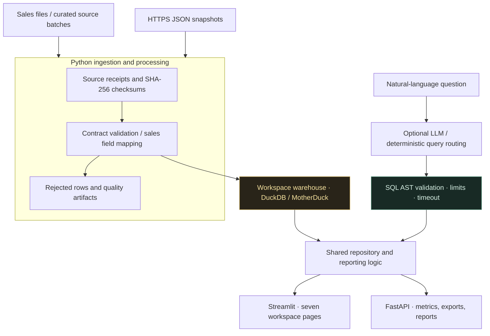

<div align="center">

# DataFlow AI

### From sales exports to traceable analytics.

Import, validate, explore, and ask questions of your data in one workspace.

[](https://github.com/LalitSoni19/DataFlow-AI/actions/workflows/ci.yml)


**[Open the live app](https://dataflow-ai-lalitsoni.streamlit.app/)** · **[Quickstart](#quickstart)** · **[Architecture](#architecture)** · **[Operations guide](docs/runbook.md)**

</div>



*Application screenshot from a local run with synthetic sales data. The example recognizes $235 across two completed or paid sales and excludes a $15 refund.*

## The workflow

DataFlow AI turns sales files into a queryable warehouse with import history, data-quality checks, dashboards, and an optional natural-language assistant. Python handles ingestion and validation, DuckDB or MotherDuck stores the analytical model, and a shared repository serves Streamlit and FastAPI.

| Step | What you do | What the platform provides |
| --- | --- | --- |
| **Import** | Upload CSV, TSV, XLSX, JSON, or JSONL files, or fetch an HTTPS JSON endpoint. | A preview of detected fields, row counts, currencies, and mapping warnings. |
| **Review & publish** | Confirm the preview and publish the import. | Source receipts, checksums, quality results, and a versioned import history. |
| **Explore** | Open sales metrics, browse tables, or run analytical SQL. | Revenue trends, product performance, currency coverage, and CSV exports. |
| **Ask & report** | Ask a sales question or generate a monthly report. | Guarded SQL execution, query results, and downloadable reporting output. |

<details>
<summary><strong>Watch the upload-to-answer walkthrough</strong></summary>



*Recorded locally using synthetic data.*

</details>

The live demo creates a private workspace for each anonymous browser session. With MotherDuck configured, each session receives a distinct cloud database. Reconnecting can start a new workspace. Persistent access uses authenticated workspaces associated with a verified identity. [Workspace setup](docs/runbook.md#customer-workspaces)

## Architecture



The dashboard calls the Python services directly. The API offers a separate interface to the same pipeline and warehouse logic. Airflow invokes the pipeline runner for scheduled work, while the included dbt project models the curated sales transformations.

### Two ingestion paths

| Path | Input | Published model |
| --- | --- | --- |
| **Curated batch** | Customer, product, order, order-item, and website-event source files. | Contract-validated staging data, dimensions, sales facts, and reporting aggregates. |
| **Flexible sales export** | Sales files with business-specific column names. | Detected semantic mappings, canonical sales records, and a source-shaped table for inspection. |

### Engineering decisions

- **Traceable imports.** Source receipts include checksums, and completed imports can be restored as new versions. Cloud imports archive source bytes and processing artifacts in MotherDuck.
- **Explicit reporting semantics.** Currency groups remain separate. Missing values retain their meaning, and status fields determine which sales contribute to recognized revenue. Review the metric definitions before integrating downstream reports. [Data dictionary](docs/data_dictionary.md)
- **Workspace isolation.** Anonymous dashboard sessions use private storage. Authenticated workspaces derive their scope from the verified issuer and subject. Direct pipeline jobs operate on their configured warehouse. [Operations guide](docs/runbook.md)
- **Controlled SQL execution.** The query guard parses SQL into an abstract syntax tree, restricts tables and functions, blocks mutations and external scans, and enforces result limits and execution timeouts. [AI safety design](docs/ai_safety.md)
- **Optional AI dependency.** Provider configuration enables model-generated SQL. Deterministic routing supports a limited set of sales questions when a model is unavailable.

## Quickstart

Requires **Python 3.10+**. Local dashboard exploration works with DuckDB and requires no cloud credentials.

```bash
git clone https://github.com/LalitSoni19/DataFlow-AI.git
cd DataFlow-AI
python -m venv .venv
```

Activate the environment using the command for your shell.

| Shell | Command |
| --- | --- |
| PowerShell | `.\.venv\Scripts\Activate.ps1` |
| macOS / Linux | `source .venv/bin/activate` |

```bash
python -m pip install -e ".[dev]"
python -m streamlit run streamlit_app/app.py
```

Open [localhost:8501](http://localhost:8501). Choose **Build Sample Warehouse**, or open **Import data**, upload a sales file, select **Preview import**, and then **Publish reviewed files**.

### Run the pipeline and API

For scripted ingestion and API exploration, populate the configured warehouse and start the API.

```bash
python scripts/run_pipeline.py --regenerate-sample
python scripts/run_api.py
```

The default local warehouse is `data/warehouse/dataflow.duckdb`. Browse the interactive API documentation at [localhost:8000/docs](http://localhost:8000/docs).

To process your own source directory, run the following command before starting the API.

```bash
python scripts/run_pipeline.py --source-dir "/path/to/sales-files"
```

**The anonymous dashboard has its own session workspace.** Import files through the dashboard to explore them there. Configure authenticated workspaces when the dashboard and API should serve the same user's persistent data.

## Configuration

Use `.env` for local configuration and your deployment's secret store for hosted credentials. `.env.example` contains configuration examples.

| Purpose | Settings | Behavior |
| --- | --- | --- |
| Local storage | `DATAFLOW_DATA_DIR`, `DATAFLOW_DATABASE_PATH` | Configure pipeline and API data paths. Anonymous dashboard storage is scoped separately. |
| Cloud warehouse | `MOTHERDUCK_TOKEN`, `DATAFLOW_DATABASE_URL` | Set a writable database URI such as `md:dataflow_ai`. Workspace provisioning requires database creation and write permissions. |
| Hosted AI | `LLM_BASE_URL`, `LLM_API_KEY`, `LLM_MODEL` | Configure an OpenAI-compatible provider endpoint and model. |
| Local AI | `OLLAMA_BASE_URL`, `OLLAMA_MODEL` | Use a running Ollama service. |
| Request budgets | `LLM_TIMEOUT_SECONDS`, `LLM_MAX_RETRIES`, `AI_QUERY_TIMEOUT_SECONDS` | Defaults are 20 seconds, two retries, and eight seconds respectively. |
| Managed identity | `DATAFLOW_AUTH_REQUIRED`, `DATAFLOW_OIDC_ISSUER`, `DATAFLOW_OIDC_AUDIENCE`, `DATAFLOW_OIDC_JWKS_URL` | Enable verified user workspaces. Streamlit additionally requires native OIDC auth secrets. |

### Deployment considerations

Hosted customer deployments require identity-provider configuration, server-side secrets, storage retention, and appropriate warehouse permissions. Anonymous cloud databases need an operator-managed retention policy. Local durable workspaces require persistent storage and functioning file locks. [Deployment and recovery instructions](docs/runbook.md)

Docker Compose includes API and dashboard services. Configure the required JWT secret, trusted origins, and identity settings before starting the stack.

```bash
docker compose --env-file .env up --build
```

## API surface

| Method | Route | Purpose |
| --- | --- | --- |
| `GET` | `/health` | Service health |
| `GET` | `/api/kpis/overview` | Revenue, order, and customer metrics |
| `GET` | `/api/sales` | Sales aggregates |
| `GET` | `/api/products/top` | Product rankings |
| `GET` | `/api/pipeline/status` | Pipeline status and row counts |
| `GET` | `/api/data-quality` | Quality results |
| `GET` | `/api/metadata/tables` | Available analytical tables |
| `GET` | `/api/exports/sales.csv` | Sales export |
| `GET` | `/api/reports/monthly` | Monthly report |
| `POST` | `/api/ask` | Natural-language analytics |
| `POST` | `/api/privacy/customers/{customer_id}/delete` | Authorized customer anonymization |

Request schemas, query parameters, and response models are available in the running API's Swagger documentation.

## Development and verification

```bash
python -m pytest
```

The test suite covers ingestion, reporting semantics, SQL restrictions, privacy controls, cloud configuration, API behavior, and Streamlit visibility. The session-isolation regression publishes an import in one dashboard session and checks that a second session has an empty dashboard and import history. GitHub Actions runs the suite on Python 3.10 and 3.12 and smoke-tests the installed wheel.

For a local browser walkthrough, the repository includes `scripts/verify_local_ui.py`. It requires Playwright and Microsoft Edge, starts temporary local services, and exercises all seven dashboard pages with synthetic data.

| Location | Responsibility |
| --- | --- |
| `src/dataflow_ai/ingestion/` | File readers, API ingestion, raw storage, and sales profiling |
| `src/dataflow_ai/processing/` | Cleaning and validation |
| `src/dataflow_ai/warehouse/` | Schema, transactions, and analytical queries |
| `src/dataflow_ai/ai/` | Query routing, provider clients, prompts, and SQL guard |
| `src/dataflow_ai/api/` | HTTP routes, authentication, and rate limiting |
| `src/dataflow_ai/pipeline.py` | Pipeline orchestration and import restoration |
| `streamlit_app/` | Dashboard pages and shared UI components |
| `tests/` | Automated regression suite |
| `dbt/` · `airflow/` | Optional transformation and orchestration integrations |

<details>
<summary><strong>Optional dbt and Airflow setup</strong></summary>

Install the extras for the integration you intend to run.

```bash
python -m pip install -e ".[dbt]"
python -m pip install -e ".[orchestration]"
```

For dbt, adapt `dbt/profiles.yml.example` into your dbt profile directory, then run `dbt build --project-dir dbt`.

For Airflow, set `DATAFLOW_PROJECT_ROOT` to the repository directory and make `airflow/dags/sales_pipeline.py` available in your Airflow DAG directory. Configure persisted source snapshots and prevent overlapping runs against the same warehouse.

</details>

## Technical documentation

| Guide | What it covers |
| --- | --- |
| [Architecture](docs/architecture.md) | Processing paths and service boundaries |
| [Data dictionary](docs/data_dictionary.md) | Analytical models and metric definitions |
| [AI safety](docs/ai_safety.md) | Query restrictions and deployment boundaries |
| [Operations runbook](docs/runbook.md) | Configuration, identity, restoration, and cloud operation |
