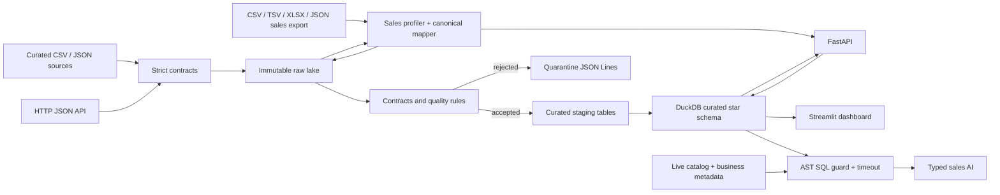

# DataFlow AI architecture

DataFlow AI keeps the data-engineering foundation separate from the optional AI layer. Raw source bytes are immutable and hash-tracked. A full curated batch follows strict contracts; arbitrary sales exports follow a profiler-to-canonical-sales path that preserves source columns and publishes a reviewed semantic mapping.

The local runner is the executable reference pipeline. The optional Airflow DAG invokes that same runner on a schedule, avoiding two divergent ETL implementations. dbt models mirror the curated transformation logic for teams that prefer dbt build and test workflows.

